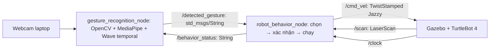

# Bài 6 — Điều khiển TurtleBot 4 bằng cử chỉ tay

Nguyễn Minh Nghĩa · 23020755. Ubuntu **24.04 LTS**, ROS 2 **Jazzy**, Gazebo **Harmonic**, Python 3.12.
Đề ghi Humble/22.04; bài này dùng Jazzy phù hợp máy 24.04 hiện tại.
Mã/bản đồ/minh chứng bài trước được giữ tại `src/tb4_simulation_lab` và [hướng dẫn cũ](docs/README_Nav2_YOLO.md).

## Kiến trúc



| Cử chỉ / tên topic | Kết quả |
|---|---|
| Vẫy tay / `Wave` | Chọn chào: xoay trái–phải 4 pha, mỗi pha 1 giây |
| 1 ngón / `Pointing_Up` | Chọn tiến–lùi **4 cặp**, mỗi lượt 1,5 giây |
| 2 ngón / `Victory` | Chọn tròn: v=0,12 m/s, ω=0,3 rad/s, bán kính 0,4 m |
| Ngón cái / `Thumb_Up` | Xác nhận và chạy hành vi đã chọn |
| Xòe tay / `Open_Palm` | Dừng ngay khi callback nhận được, xóa lựa chọn |
| Nắm tay / `Closed_Fist` | Hủy, xóa lựa chọn, về chờ |

Wave là quy tắc chuyển động cổ tay trên landmark MediaPipe: ít nhất 2 lần đổi
hướng, biên độ mỗi đoạn ≥0,10 chiều rộng ảnh trong 1,5 giây. Đây không phải lớp AI
có sẵn. Xòe tay tĩnh luôn có ưu tiên dừng; bắt đầu vẫy cũng dừng trước khi chọn chào.
Giữ vẫy đến khi màn hình hiện `SELECTED: wave`, sau đó chuyển sang ngón cái.
Confidence hiển thị cho Wave là confidence Open Palm nền, không phải xác suất của bộ nhận diện Wave.

## Cài đặt và build

```bash
cd ~/turtlebot4
source /opt/ros/jazzy/setup.bash
sudo apt update
sudo apt install ros-jazzy-turtlebot4-simulator ros-jazzy-ros-gz-sim \
  ros-jazzy-ros-gz-bridge python3-venv python3-colcon-common-extensions python3-pytest python3-reportlab
python3 -m venv --system-site-packages .venv-gesture
.venv-gesture/bin/python -m pip install -r requirements-gesture.txt
mkdir -p models
curl -fL --connect-timeout 15 --max-time 180 \
  https://storage.googleapis.com/mediapipe-models/gesture_recognizer/gesture_recognizer/float16/1/gesture_recognizer.task \
  -o models/gesture_recognizer.task.part && \
mv models/gesture_recognizer.task.part models/gesture_recognizer.task
colcon build --symlink-install --packages-select tb4_gesture_control
source install/setup.bash
```

Nếu chuyển workspace, truyền `python:=/đường/dẫn/.venv-gesture/bin/python`
và `gesture_model:=/đường/dẫn/gesture_recognizer.task` khi launch.
Không cài pip vào Python hệ thống. Venv cần `--system-site-packages` để thấy rclpy.

## Chạy demo

Terminal 1:

```bash
cd ~/turtlebot4
source /opt/ros/jazzy/setup.bash
source install/setup.bash
ros2 launch tb4_gesture_control simulation.launch.py
```

World riêng có mặt sàn 30×30 m, không đồ đạc; dùng Ogre2 cho LiDAR trên máy này.
Đợi robot xuất hiện, đồng hồ và scan hoạt động. Robot upstream khởi động trên dock.
**Chuẩn bị trước khi quay**: thực hiện undock bằng action rồi kéo dock ra xa robot
trong Gazebo nếu khoảng cách dưới 0,55 m; kiểm tra xung quanh robot trống ít nhất 2 m.

```bash
ros2 action send_goal /undock irobot_create_msgs/action/Undock '{}'
ros2 topic type /cmd_vel
ros2 topic hz /scan
```

Terminal 2 (sau chuẩn bị):

```bash
cd ~/turtlebot4
source /opt/ros/jazzy/setup.bash
source install/setup.bash
ros2 launch tb4_gesture_control gesture.launch.py
# Webcam USB khác: thêm camera:=2
```

Trong demo chỉ dùng tay, không điều khiển robot bằng bàn phím. Chọn rồi giơ ngón cái
≥0,35 giây. Khi đang chạy, giữ ngón cái trong camera để duy trì tín hiệu.
Nếu ánh sáng yếu, tăng ánh sáng/đưa tay rõ trong khung; có thể hiệu chỉnh
`confidence:=0.55` nhưng cần thử lại chống nhiễu.
Khi đang chạy, đưa tay ra khỏi camera sẽ dừng sau khoảng 0,8 giây + chu kỳ 50 ms;
cần chọn/xác nhận lại. Khi mới chọn, bạn có 5 giây để đổi tay sang ngón cái;
robot vẫn đứng yên trong lúc chờ xác nhận.
Để thử từng hành vi: Pointing Up → Thumb Up; Victory → Thumb Up; Wave → Thumb Up.
Thử Open Palm và Closed Fist giữa chuyển động, rồi thử che camera.

## Cơ chế điều khiển và giới hạn

- Confidence ≥0,65; lệnh chọn/xác nhận phải ổn định 0,35 giây.
- Mỗi cử chỉ ổn định kích hoạt một lần; giữ ngón cái không lặp lại hành vi.
- Open Palm/Closed Fist bỏ qua debounce để dừng ngay; lệnh chọn khi đang chạy bị bỏ qua.
- Watchdog dùng thời gian monotonic, timer steady 20 Hz: mất camera, tiến trình AI treo,
  không có cử chỉ hợp lệ hoặc topic ngừng phát khi đang chạy → dừng và xóa trạng thái.
  Lựa chọn chờ xác nhận tồn tại tối đa 5 giây sau cử chỉ chọn gần nhất.
- LiDAR phải mới trong 1 giây, không NaN/giá trị dưới range_min, mọi điểm ≥0,55 m;
  dữ liệu lỗi/vật cản → hủy chuyển động, cần chọn lại. Đây là hàng rào dừng bảo thủ,
  không phải thuật toán tránh chướng ngại/đảm bảo không va chạm trong mọi môi trường.
- Thời lượng chuyển động dùng ROS clock để mô phỏng chậm không làm mất chu trình.
  Chuyển động vòng tròn/tiến–lùi là điều khiển vận tốc vòng hở, có sai số vật lý.
- Jazzy dùng TwistStamped. Chỉ thêm `stamped:=false` khi topic đích thực sự là Twist.
- Chỉ chạy một nguồn phát `/cmd_vel`; dừng Nav2/teleop của bài cũ trước.
- Nếu chính behavior process bị kill -9, watchdog của process đó không còn hoạt động;
  vẫn cần cơ chế timeout vận tốc ở bộ điều khiển robot downstream.

## Kiểm thử và nộp bài

```bash
colcon test --packages-select tb4_gesture_control
colcon test-result --verbose
# Hoặc chạy trực tiếp:
python3 -m pytest src/tb4_gesture_control/test -q
```

Xem [kịch bản demo và trạng thái bàn giao](docs/lab6/validation.md),
[báo cáo](docs/lab6/report.pdf). Báo cáo ghi rõ phần nào đã kiểm chứng, phần nào cần
sinh viên quay/chụp thực nghiệm. Không dùng ảnh bài YOLO làm minh chứng bài cử chỉ.
Video cần thấy đồng thời webcam và Gazebo, đủ 6 cử chỉ, chọn trước xác nhận,
chống lặp, dừng/hủy/mất tín hiệu. Upload Drive và bật “Anyone with the link”.
Source Bài 6 nằm trên [nhánh assignment-6-hand-gesture](https://github.com/ngaingu-05/turtlebot4-nav2-yolo/tree/assignment-6-hand-gesture).
[Link GitHub và thư mục Google Drive từ báo cáo cũ](docs/lab6/links.md).
Điền URL video Bài 6 vào `docs/lab6/submission.json` sau khi quay/upload.

## Tài liệu

- [MediaPipe Gesture Recognizer Python](https://ai.google.dev/edge/mediapipe/solutions/vision/gesture_recognizer/python)
- [TurtleBot 4 simulator Jazzy](https://github.com/turtlebot/turtlebot4_simulator/tree/jazzy)
- [OpenCV VideoCapture](https://docs.opencv.org/4.x/d8/dfe/classcv_1_1VideoCapture.html)
