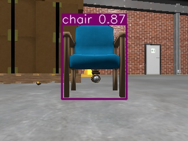

# Kết quả kiểm thử tích hợp — 15/10/2026

Workspace `/home/nghia/turtlebot4`, Ubuntu 24.04, ROS 2 Jazzy, Gazebo Harmonic,
TurtleBot 4 Standard, world Depot, YOLOv8n CPU. Không sử dụng ảnh ghi sẵn làm input.

## Quy trình thực tế

1. Build workspace, chạy hai unit test.
2. Khởi động Gazebo/RViz, AMCL + Nav2 và YOLO ở các process riêng, cùng ROS_DOMAIN_ID=42.
3. Tắt E-stop trong mô phỏng, chạy action Undock; nhận status=4, is_docked=false.
4. Lấy pose thật `/sim_ground_truth_pose`, đặt initial pose AMCL với thời gian mô phỏng.
   Ground truth chỉ phục vụ kiểm thử, không thay nguồn định vị của node navigation.
5. Kiểm tra AMCL và sáu lifecycle node, TF map→base_link.
6. Chọn hai cell có khoảng hở >0,7 m trong vùng trống liên thông của map, Goal 3
   là pose AMCL đã đo sau undock. Planner ComputePathToPose xác nhận ba chặng.
   Hướng đích lấy theo tiếp tuyến cuối đường planner, không gán yaw ngẫu nhiên.
7. Chạy node navigation tùy chỉnh; YOLO chạy liên tục cùng lúc, không teleop.
8. Sau chuỗi đầu, thêm static Chair từ Fuel cache trước camera để kiểm tra dương tính.
9. Thử lại bằng launch tích hợp autonomous_yolo, giữ cảnh có ghế.

## Ba đích đã cấu hình

| Goal | x (m) | y (m) | yaw (rad) | Số pose của đường kiểm tra |
|---|---:|---:|---:|---:|
| 1 | -2.468 | 0.503 | 1.892550 | 88 |
| 2 | -0.318 | 1.553 | 0.785399 | 96 |
| 3 | -0.345763 | 0.006710 | -1.609538 | 59 |

Planner action đều trả status=4. Đây là kiểm tra đường đi; thành công chuyển động
được xác nhận riêng trong navigation.log bằng kết quả NavigateToPose thực.

## Kết quả

| Yêu cầu | Trạng thái | Minh chứng |
|---|---|---|
| Build hiện tại | PASS | build.log: 1 package finished |
| Unit tests | PASS | unit_tests.log: 2 tests OK |
| Depot + robot + controller | PASS | simulation.log |
| Undock | PASS | prepare.log: SUCCEEDED, is_docked=false |
| Map đúng 604×304, 0.05 m/ô | PASS | interfaces.json và nav2.log |
| AMCL định vị | PASS | Sai lệch vị trí ban đầu 0.00867 m so với truth tại thời điểm kiểm tra |
| TF map→base_link | PASS | interfaces.json |
| Lifecycle AMCL/map/planner/controller/BT/collision monitor | PASS | Tất cả active trong interfaces.json |
| Các topic bắt buộc có message thực | PASS | map, scan, odom, tf, tf_static, cmd_vel, amcl_pose trong interfaces.json |
| Action NavigateToPose | PASS | actions.txt và navigation.log |
| Ba goal liên tiếp | PASS | navigation.log: Goal 1 → 2 → 3 succeeded, sau đó all-success |
| Camera RGB sống | PASS | rgb8 320×240, 230400 byte/frame |
| cv_bridge + YOLO CPU | PASS | RGB → bgr8 → inference, yolo.log |
| Ảnh annotated nhận qua subscriber | PASS | bgr8 320×240, interfaces.json, ảnh JPG thực |
| Không phát hiện vật thể | PASS | Depot nguyên trạng: log 0 detections, node tiếp tục chạy |
| Box + class + confidence | PASS trong cảnh có Chair bổ sung | chair_live_annotated.jpg: chair 0.87 |
| Navigation và inference đồng thời | PASS | Khoảng thời gian navigation.log chồng lấp yolo.log |
| Launch tích hợp: 3 goal + YOLO | PASS | combined_launch.log: đủ 3 SUCCEEDED; 18 log nhận diện chair |
| GUI show_window=true sau sửa | PASS | yolo_gui_fixed.log, không còn cảnh báo QObject cleanup |
| Thiếu model | PASS | missing_model.log: lỗi rõ ràng và exit 1 |
| Thiếu camera | PASS | missing_camera.log: cảnh báo, node không crash |

Đo trong cửa sổ khoảng 15,04 giây thực: 80 message RGB và 33 message annotated,
tương ứng khoảng 5,32 và 2,19 message/giây ở subscriber của phiên đó. Đây là số đo
một cửa sổ có ảnh hưởng DDS discovery và tải máy, không phải benchmark ổn định.
Scan 640 tia, 454 giá trị hữu hạn hợp lệ tại lần lấy mẫu, khoảng 2,595–11,956 m.

## Nhận diện dương tính: phân biệt cảnh thử

Depot nguyên trạng cho 0 detections trong góc nhìn đã thử. Sau khi robot hoàn tất
chuỗi đầu, một **model Chair thực trong Gazebo** được spawn tại (-0.52,-1.03,0),
yaw=1.39 rad, trước pose cuối đã đo của robot. Chair dùng mesh OpenRobotics đã có
trong Fuel cache; fixture static chỉ tồn tại trong phiên mô phỏng. Camera thật
nhìn thấy model và detector trả chair 0.87. Không chèn ảnh/box thủ công, không đổi
PGM/YAML hoặc world Depot gốc. Ghế thử có thể không tiếp đất hoàn hảo theo gốc mesh;
đây là fixture thị giác static, không phải mô hình đánh giá động lực học ghế.



## Giới hạn và lỗi đã gặp

- Lần probe đầu publish initial pose trước khi DDS discovery hoàn tất, không nhận
  pose AMCL trong 40 s. Retry phát initial pose theo thời gian thực trong 8 s, có
  use_sim_time=true, nhận AMCL và xác minh với truth thành công. Giữ cả log lỗi và retry.
- Có warning TF initial pose lệch dữ liệu vài ms, sau đó TF và localization hợp lệ.
- Gazebo báo controller yêu cầu 1 ms trong khi physics step 3 ms; controller vẫn
  active và hai vòng navigation thực kiểm tra bằng action result, không dựa warning.
- Qt GUI thử đầu nhận diện được nhưng báo timer cleanup từ thread khác. Đã sửa
  imshow/waitKey/destroyAllWindows sang main thread; inference vẫn ở worker.
- XWD cửa sổ Gazebo bị occlusion bởi RViz, nên ảnh đó được đặt tên rõ
  `occluded_gazebo_capture_rviz_visible.png`; không coi là ảnh chứng minh Gazebo.
- Không có screenshot riêng cho từng goal; log action là minh chứng từng goal.
- Không khẳng định mọi vật thể trong Depot đều được COCO nhận diện.
- Workspace hiện không phải Git repository hợp lệ (`git status` báo not a git repository).
  Không khởi tạo/xóa Git history hoặc push trong phiên kiểm thử.

## Lệnh chạy lại

Source `/opt/ros/jazzy/setup.bash` và `install/setup.bash` trong mỗi terminal.

```bash
# Terminal 1
ros2 launch tb4_simulation_lab gazebo_rviz.launch.py joy:=false
# Terminal 2
ros2 launch tb4_simulation_lab localization_navigation.launch.py
```

Undock, đặt 2D Pose Estimate tại đúng vị trí/hướng thực. Khi Nav2 active:

```bash
# Terminal 3, cd /home/nghia/turtlebot4
source .venv-yolo/bin/activate
ros2 launch tb4_simulation_lab autonomous_yolo.launch.py \
  goals_file:=/home/nghia/turtlebot4/src/tb4_simulation_lab/config/navigation_goals.yaml \
  yolo_model:=/home/nghia/turtlebot4/models/yolov8n.pt show_window:=false
```

Công cụ phục vụ test trong `evidence/integration_2026-10-15/reproduction/`.
Không chạy công cụ ground truth trên robot thật. Khi restart Gazebo, Chair thử sẽ
không còn; cần tạo lại fixture nếu muốn lặp phép thử nhận diện dương tính.

## Tổng kết hai lượt chạy và trạng thái sau test

- Lượt node riêng: **3/3 goal**, khoảng **110,50 giây thực** từ gửi Goal 1 đến all-success.
- Lượt launch tích hợp: **3/3 goal**, khoảng **146,04 giây thực**.
- Monitor trong khoảng 433 giây ghi nhận **2.891 RGB frame** và **805 annotated frame**.
- 103 mẫu so sánh AMCL với ground truth mới nhất tại callback: median sai lệch vị trí
  khoảng **0,061 m**, lớn nhất **0,137 m**. Đây là ghép pose mới nhất, chưa đồng bộ
  timestamp chính xác; không coi là benchmark độ chính xác localization.
- Có 18 log chair trong lượt launch tích hợp, confidence lớn nhất 0,87. Đồng thời
  từng xuất hiện nhãn nhầm umbrella/suitcase, cần ghi rõ false positive/domain gap.
- GUI sau sửa đã thử show_window=true và Ctrl+C kết thúc bằng timeout có chủ đích;
  không còn QObject cleanup warning. Mã timeout 124 là kết thúc bài thử, không phải crash.
- Đã dừng các process mô phỏng, Nav2 và detector do phiên test tạo sau khi hoàn thành;
  không để robot tiếp tục chạy nền.

Số liệu máy đọc được: [summary.json](evidence/integration_2026-10-15/summary.json).
Lần build cuối: `1 package finished [1.37s]`; hai unit test cuối đều OK. Checksum
map vẫn trùng trước triển khai. Không phát sinh FAIL chưa xử lý trong bộ kiểm tra
chức năng cuối; các lần lỗi trung gian được giữ trong evidence.
